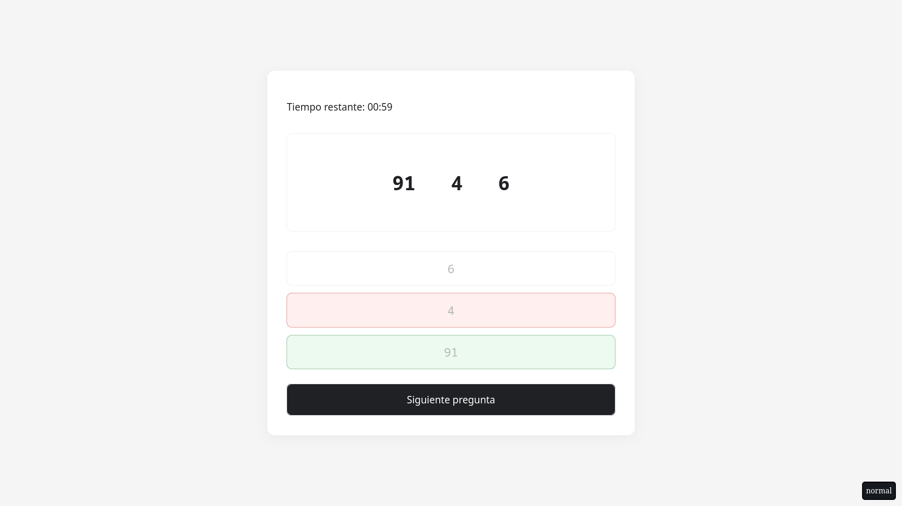

# Test de aptitud

Esta es una aplicación para practicar con pruebas psicométricos.

## ¿Qué encontrarás en la prueba?

La evaluación está dividida en cuatro secciones:

1. **Razonamiento:** preguntas basadas en relaciones y comparaciones.
2. **Rapidez numérica:** ejercicios breves de identificación de números.
3. **Rapidez perceptiva:** comparación rápida de grupos de letras y caracteres.
4. **Significado de palabras:** preguntas sobre relaciones entre palabras en español.

## Ejemplos de preguntas

## Cómo iniciar la aplicación

Para realizar la evaluación, accede a la aplicación desde la siguiente página.

[https://aptitud-test.vercel.app/](https://aptitud-test.vercel.app/)
